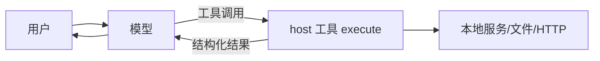
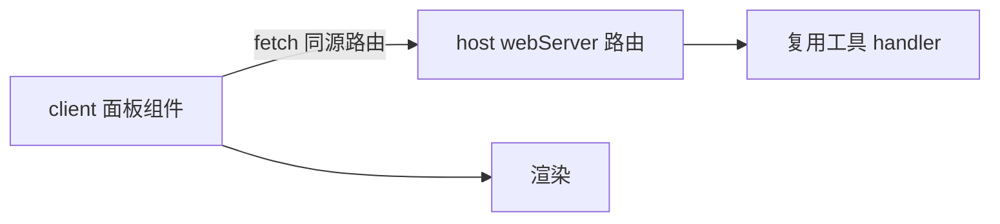

# 01 · 概念地图与术语

## 从上往下看

```
DeepSeek Harness（应用：Web / 桌面）
└── profile            一个 npm 工程，决定装哪些插件（如 web）
    ├── package.json   依赖 + dsh.profile.bundles
    └── node_modules/  插件包
        └── bundle     一个可安装的插件包
            ├── cordis.patch.yml   往 profile 里“插一行”
            └── lib/index.js       真正被加载的插件代码
```

- **profile**：插件组合的最小单位。不同 profile 互相隔离，适合做实验和验收。
- **bundle**：一个 npm 包 + 一份 patch。安装 = 把包放进 profile + 把 patch 应用上去。
- **entry**：patch 里的一行，`id` 唯一，后续层可以按 id 覆盖或禁用。
- **插件（plugin）**：entry 指向的模块，导出 `name` / `inject` / `apply`。

## 两半：host 与 client

| | host | client |
| --- | --- | --- |
| 运行环境 | Node.js 进程 | 浏览器页面 |
| 入口 | `lib/index.js`（`main`） | `lib/client.js`（`exports["./client"]`） |
| 能做什么 | 文件、进程、网络、工具、HTTP 路由 | DOM、React 组件、槽位 |
| 不能做什么 | DOM | 文件系统、Node API |
| 怎么加载 | 启动时 import | 页面加载时执行 loader 注册 |

**它们不共享内存。** host 要用 `ctx.tools.register` 暴露能力；client 要拿数据，只能走 HTTP（同源路由或本机服务）。

## Cordis 的四个概念

| 概念 | 一句话 | 在插件里长什么样 |
| --- | --- | --- |
| Context | 插件拿到的运行时句柄 | `apply(ctx)` 的参数 |
| service | 挂在 ctx 上的能力 | `ctx.tools`、`ctx.slots`、`ctx.webServer` |
| inject | 声明“我需要哪些服务” | `export const inject = ['tools']` |
| effect | 注册可回收资源，返回 disposer | `ctx.effect(() => dispose, 'label')` |

依赖注入的规则：**用了哪个服务，就要在 `inject` 里声明**。没声明就取属性，Cordis 会拒绝（见 [03](03-host-工具与生命周期.md)）。

## 常用服务

| 服务 | 所在侧 | 用途 |
| --- | --- | --- |
| `tools` | host | 注册模型可调用的工具 |
| `slots` | client | 往界面槽位注册组件 |
| `sidebarRightTabs` | client | 注册右侧栏 tab 类型 |
| `connection` | host | 浏览器连接、信任边界 |
| `webServer` | host | 注册同源 HTTP 路由 |
| `credentials` | host | 读取密钥（不要自己读环境变量当唯一来源） |
| `deepseekAccount` | host | 账号登录态、余额等 |
| `sessionTitle` | host | 会话标题（展示用，可选） |

具体可用服务随 dsh 版本变化，写之前先查官方文档或 `ctx` 的类型定义。

## 一次工具调用的数据流



## 一次面板渲染的数据流



## 术语表

| 术语 | 含义 |
| --- | --- |
| dsh | DeepSeek Harness 的缩写 |
| cordis | dsh 使用的插件/依赖注入框架 |
| bundle | 可分发的插件包（npm 包 + patch） |
| patch | 追加到 profile 的配置层 |
| entry | patch 里的一行插件声明 |
| slot | 前端可注册组件的具名位置 |
| panel id | 主区页面与侧边栏入口共享的标识 |
| platform seed | 浏览器里预置的模块（目前是 React） |
